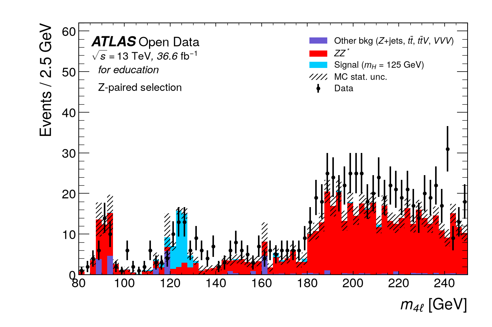
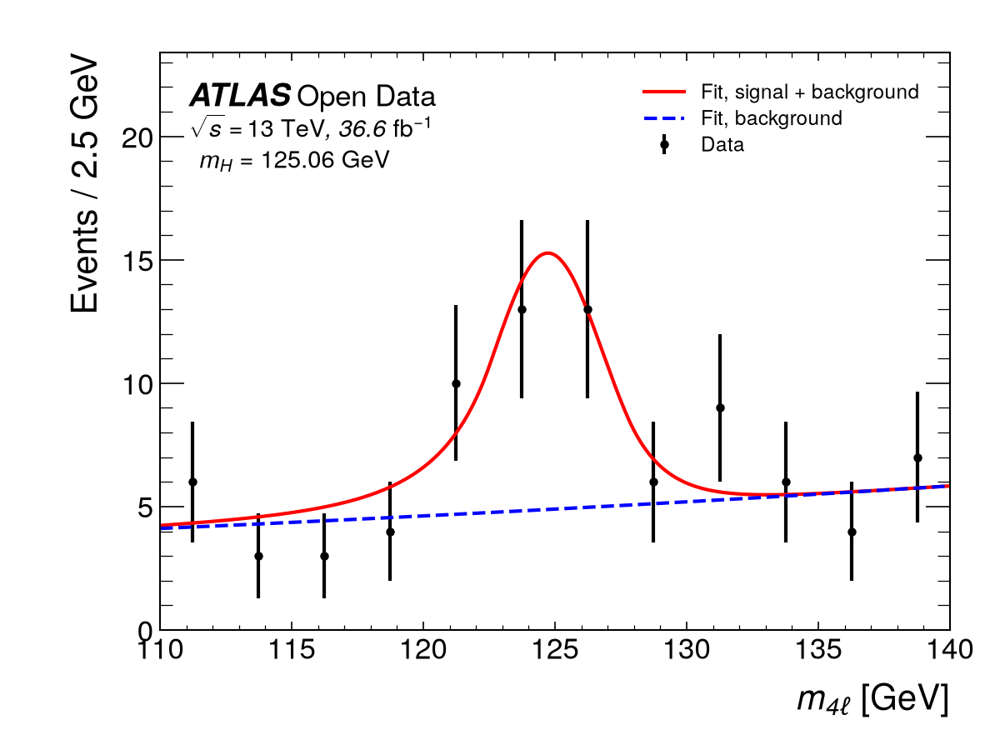
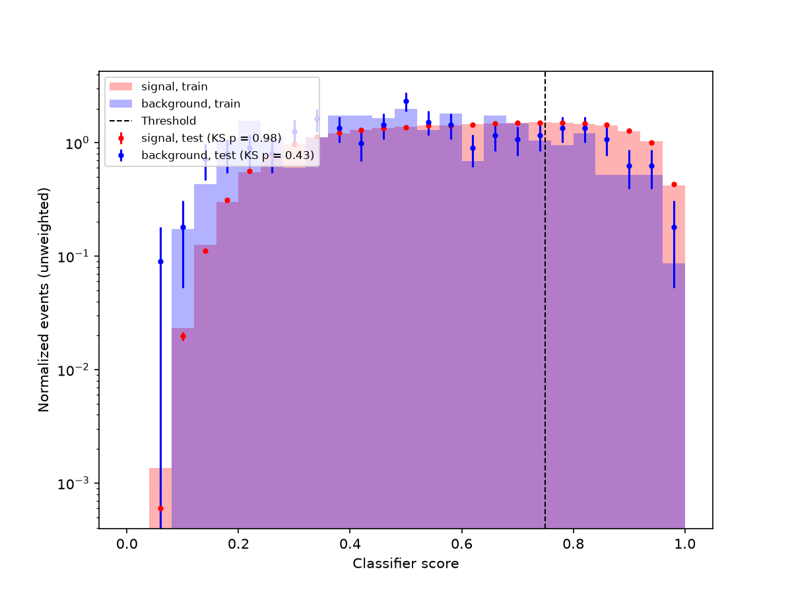

# higgs4l

A small, reproducible analysis of the Higgs boson in the H → ZZ* → 4ℓ channel with the
ATLAS 2025 Open Data for education (13 TeV, 2015-2016, 36.6 fb⁻¹). It starts from the official
ATLAS notebook, reproduces its numbers, and then goes further in three ways: a likelihood
measurement of the Higgs mass with a calibrated uncertainty, a profile-likelihood significance,
and a classifier whose gain in expected significance is measured on events it never saw.

Status: phases 1 (selection, notebook reproduction), 2 (mass fit) and 3 (profile-likelihood
significance) are done, each validated on simulation and then applied to data. Phase 4
(classifier) is done on simulation; its fit to data is next.

## Results

All numbers are in the 122.5-130 GeV window used by the notebook, unless stated otherwise.

| Quantity | Value | Method | Script → result |
| --- | --- | --- | --- |
| Notebook N_sig as printed (= S + B) | 28.729 | notebook selection, abs weights, 7 signal samples | `phase1_numbers.py` → `results/phase1.json` |
| Notebook N_bg (B) | 10.301 | same | same |
| Notebook metric (S+B)/√(B+0.3B²) | 4.426 | same | same |
| True signal S | 18.428 | same | same |
| S/√B | 5.742 | counting, same S and B | same |
| Asimov Z, no background uncertainty | 4.699 | Cowan et al. 2011, same S and B | same |
| Asimov Z, 10% / 30% background uncertainty | 4.377 / 3.075 | same | same |
| Asimov Z, corrected selection | 7.82 (S = 28.84, B = 6.64) | sorted pT + Z pairing, signed weights, 8 signal samples | same |
| Data/MC in 180-250 GeV, corrected selection | 1.40 | signed weights | same |
| Peak calibration δ = fitted DSCB mean − 125 GeV | −0.350 ± 0.010 GeV | DSCB fit, H→ZZ*→4ℓ simulation (even events) | `mass_model.py` → `results/mass_model.json` |
| Expected uncertainty on m_H | 0.50 GeV | median MINOS error, 2000 toys at simulated yields | `mass_toys.py` → `results/mass_toys.json` |
| Toy pulls (mean, width) | −0.010 ± 0.023, 1.013 ± 0.016; 0 failed fits | 2000 toys | same |
| m_H fitted on held-out simulation | 125.15 GeV (generated 125.0; MC stat. ≈ 0.26, expected data error 0.50) | odd-event simulation as weighted pseudo-data | `mass_simulation.py` → `results/mass_simulation.json` |
| Shift with a Gaussian signal shape / all-background shape | +0.23 / +0.09 GeV | same pseudo-data | same |
| **m_H, data** | **125.06 +0.93 −0.92 GeV** (stat. only) | frozen model, 84 events in 110-140 GeV, MINOS | `mass_data.py` → `results/mass_fit.json` |
| Fitted yields in data, N_s / N_b | 24.9 ± 7.9 / 59.1 ± 9.8 (simulation: 39.1 / 27.6) | same fit, Hesse errors | same |
| Fit quality | Poisson deviance 5.9 for 9 d.o.f., p = 0.75 | 12 bins of 2.5 GeV | same |
| Data / simulated S+B in 110-120, 120-130, 130-140 GeV | 16 / 16.7, 42 / 42.6, 26 / 7.4 | counts, signed weights | same |
| Toys with an error ≥ 0.93 GeV | 0.9% at simulated yields; 30% at the data yields (median 0.78 GeV) | 2000 P2-a toys; 500 toys at the fitted yields, 2 MINOS failures kept | same |
| Shift with a Gaussian signal shape / all-background shape, data | +0.91 / +0.41 GeV | same data | same |
| P2-d: ATLAS, 36.1 fb⁻¹, 4ℓ | 124.79 ± 0.37 GeV; ours differs by +0.27 GeV | Phys. Lett. B 784 (2018) 345 | same |
| P2-e: PDG average | 125.13 ± 0.11 GeV; ours differs by −0.07 GeV | PDG Live S126M, 2026 | same |
| P3-a to P3-g: single-bin pyhf Z_A vs closed form | agree to 1e-5 relative | pyhf q0 on Asimov data, shapesys for background uncertainty | `tests/test_significance.py` |
| P3-h: toys vs asymptotics, s = 10, b = 5 | toy p0 2.31e-4 (exact Poisson 2.26e-4) vs asymptotic 1.59e-4: Z 3.50 vs 3.60 | 10⁷ counting toys | `significance.py` → `results/significance_expected.json` |
| Expected Z, shape fit 110-160 GeV, background normalization free | 6.64 (8.74 with background fixed to simulation) | pyhf, Asimov, lumi 0.87%, MC stat per bin | same |
| Expected Z from 1000 s+b toys | 6.50 ± 0.04 (Asimov 6.64 is 3.4σ high) | same model | same |
| Expected μ uncertainty | +0.21 −0.19 | profile scan on Asimov data | same |
| **Observed Z, data** | **3.96** (asymptotic, p0 = 3.8e-5) | frozen model, 124 events in 110-160 GeV | `significance_data.py` → `results/significance.json` |
| **μ̂, data** | **0.72 +0.22 −0.20** | profile scan | same |
| Fitted background / simulated | 96.6 / 53.7 events (μ_b = 2.09) | same fit | same |
| Expected Z at the fitted background (a posteriori) | 5.18 | Asimov at fitted nuisances, μ = 1 | same |
| Classifier ROC AUC, test / train half | 0.702 / 0.763 | logistic regression, 10 features, m4l excluded; train even, test odd eventNumber | `classifier.py` → `results/ml.json` |
| P4-a: train vs test score KS p, signal / background | 0.98 / 0.43 (boosted trees: background 8.6e-14, replaced) | unweighted KS, reported | same |
| Expected Z, test half, inclusive / two categories | 6.06 / 5.97: no gain | pyhf, Asimov, odd-half templates ×2, free background per category | same |
| P4-b: background m4l, high vs low score | χ² 4.3/4, p = 0.37; mean m4l 129.4 vs 138.5 GeV | weighted χ², 10 GeV bins, reported | same |

The notebook's numbers are reproduced to machine precision. Its stored outputs come from 7 of
the 8 signal samples now in the notebook (346310 was added later without rerunning). With all
8, S = 19.010.

Per-cut yields for both selections are in `results/cutflow.md`. The derivations and every
finding are in `docs/learning/phase1.md`.





## What phase 1 found

- **The notebook's "leading lepton" pT cut is applied to stored positions 0, 1, 2.** Leptons
  are stored electrons first, not by pT. Applying the cut to the pT-sorted leptons is the
  largest single improvement, taking the Asimov significance from 4.91 to 6.42.
- **The notebook's printed N_sig is signal plus background**, and its 0.3 B² term corresponds
  to a 55% background uncertainty, not 30%.
- **Z1/Z2 pairing removes no data event.** No selected data event is e⁺e⁺μ⁻μ⁻. The m12 and
  m34 cuts do the work.

## What phase 2 found

- **m_H = 125.06 +0.93 −0.92 GeV** (statistical only). It differs by +0.27 GeV from the ATLAS
  four-lepton result on the same 2015-2016 data (124.79 ± 0.37 GeV), and by −0.07 GeV from
  the PDG average (125.13 ± 0.11 GeV). Both differences are under a third of our error. The
  ATLAS result uses the same collisions, so agreeing with it is not an independent test, and
  the two errors cannot be added in quadrature. Our error is 2.5 times the ATLAS one; the
  ATLAS analysis has a more complete selection and fit.
- **The error is almost twice the expected 0.50 GeV, because the data have an excess at
  130-140 GeV.** Below 130 GeV data and simulation agree (16 vs 16.7 events in 110-120 GeV,
  42 vs 42.6 in 120-130 GeV), but 130-140 GeV has 26 events where simulation predicts 7.4.
  The cause is not identified. The background shape is frozen, so the fit raises the
  background level everywhere to follow this sideband: N_b = 59.1 ± 9.8 against 27.6
  expected, and N_s = 24.9 ± 7.9 against 39.1, although the peak region itself matches
  simulation. A smaller signal over a larger background widens the likelihood. Only 0.9% of
  the toys at simulated yields have an error as large as 0.93 GeV. Toys at the fitted yields,
  an a-posteriori diagnostic, give a median of 0.78 GeV, and 30% of them reach 0.93 GeV. The
  model still describes the data: the Poisson deviance is 5.9 for 9 degrees of freedom
  (p = 0.75).
- **The shape choice matters at the level of the statistical error.** A Gaussian signal moves
  m̂_H by +0.91 GeV, against +0.23 GeV on simulation. In toys at the fitted yields this
  shift has a mean of +0.43 GeV and a spread of 0.67 GeV, so the data value is not unusual.
  The all-background shape moves m̂_H by +0.41 GeV. Both are cross-checks of the frozen
  model; neither is included as a systematic uncertainty.

## What phase 3 found

Comparison of significance methods (`results/significance_table.md`):

| Method | Notebook selection | Corrected, expected | Corrected, observed |
| --- | --- | --- | --- |
| Notebook metric (S+B)/√(B+0.3B²), window | 4.43 | 7.96 | - |
| S/√B, window | 5.74 | 11.19 | - |
| Counting Asimov, known B, window | 4.70 | 7.82 | - |
| Counting Asimov, 30% B uncertainty, window | 3.08 | 5.38 | - |
| Shape fit 110-160 GeV, B fixed to simulation | - | 8.74 | (8.63, not valid) |
| **Shape fit 110-160 GeV, B normalization free** | - | 6.64 | **3.96** |
| Same, median of 1000 s+b toys | - | 6.50 ± 0.04 | - |
| Shape fit, 5 GeV bins, B free (cross-check) | - | 6.37 | 4.18 |

The two columns differ in more than the selection: 7 against 8 signal samples, abs against
signed weights, and pT cuts on stored against sorted leptons. Shape-fit values are
asymptotic.

- **Observed significance 3.96σ, expected 6.64σ; μ̂ = 0.72 +0.22 −0.20.** The gap has two
  parts. The background fitted in data is 1.8 times the simulation, which alone lowers the
  expectation to 5.18. The signal strength is then 1.3σ below 1. Both agree with the
  phase 2 mass fit (N_s = 24.9 against 39.1, N_b about twice the simulation).
- **The background normalization floats freely.** That choice was fixed before unblinding,
  because the simulation is 40% low at 180-250 GeV. It costs 2.1σ of expected significance
  (8.74 against 6.64). The fixed-background observed 8.63 is shown only for completeness: the
  data reject that background level.
- **The usual counting formulas overstate.** In the notebook window, S/√B gives 11.2 for the
  corrected selection, against 7.82 for the Asimov formula. The full shape fit with an honest
  background treatment expects 6.64.
- **Asymptotics are slightly optimistic here.** The s+b toy median is 2% below Z_A (3.4σ with
  1000 toys). For s = 10, b = 5 the exact p-value is 1.4 times the asymptotic one (P3-h).
- **Single-bin checks.** pyhf with a shapesys background reproduces the closed-form Asimov
  significance, because shapesys is exactly the on/off likelihood behind that formula
  (`docs/learning/phase3.md`).

## What phase 4 found

- **A classifier on lepton kinematics does not improve the expected significance here.** On
  the test half, two score categories give Z_A = 5.97 against 6.06 inclusive. The high
  category is purer (S/B = 2.2 against 0.7), but it holds only about 5 background events with
  its own free normalization, and the threshold was chosen on optimistic training scores.
- **The simulated background is the limit.** 289 background events train the classifier. The
  planned boosted trees overtrained on them (train vs test KS p ≈ 1e-10, and 8.6e-14 with
  smaller trees), so the analysis uses logistic regression, which shows no overtraining.
- **The score partly learns m4l even without it.** The high-score background sits 9 GeV lower
  in m4l (score-m4l correlation −0.38), although the χ² shape test does not detect it
  (p = 0.37, with few events). The category model assumes the inclusive background shape in
  both categories, so this is a stated approximation.
- The derivations, every change made after the first model failed, and the reasons are in
  `docs/learning/phase4.md`.



## Limitations

- **With signed weights the simulation is about 40% below data** where ZZ* dominates
  (180-250 GeV). The weight normalization is verified (`scripts/check_normalization.py` →
  `results/normalization_check.json`). The likely cause is the background sample list, which
  has no gg → ZZ* sample; this is not quantified here.
- **Signal normalizations differ from the release metadata.** For 346310 and the ttH samples
  the file's cross-section differs from the release metadata by 3-20%. These samples are under
  3% of the signal in the window (`results/provenance.json`).
- **Data depart from simulation at 130-140 GeV.** The expected 0.50 GeV holds for the
  simulated yields; the data excess at 130-140 GeV doubles the fitted background and the
  error becomes 0.93 GeV. A quarter of the simulated background in 110-140 GeV (6.6 of 27.6 events)
  comes from three Z+jets events, one with weight 5.8 (`results/mass_model.json`).
- **Sparse background simulation in the significance fit.** The relative MC error per 2.5 GeV
  background bin is 29-127%. One Z+jets event with weight 5.8 is 11% of the background in
  110-160 GeV, and 53 events have negative weights. The Gaussian staterror constraint is
  crude at these widths.
- **Few systematic uncertainties in the significance.** Only the luminosity (0.87%), a free
  background normalization and MC statistics are included. There are no theory, lepton or
  background-shape uncertainties.
- **No systematic uncertainty on m_H.** The lepton energy and momentum scales are not
  varied. The calibration δ has an MC-statistical error of 0.01 GeV, which is negligible.
- **The calibration comes from one simulated mass point.** δ is measured at 125.0 GeV and
  assumed to be the same nearby.
- **Simplified selection.** It does not use the m4l-dependent m34 threshold, the ΔR cut or
  the J/ψ veto of the full ATLAS analysis.
- **Partial blinding.** Data were plotted in phase 1. Blinding here means every later choice
  is fixed on simulation before any fit to data.

## How to run

```bash
python3 -m venv .venv
.venv/bin/pip install -r requirements.txt
.venv/bin/pip install -e .
.venv/bin/pytest -q -m "not network"          # uses the committed data/selected
.venv/bin/python scripts/select_events.py      # downloads about 1 GB, rebuilds data/selected
.venv/bin/python scripts/phase1_numbers.py
.venv/bin/python scripts/plot_m4l.py
.venv/bin/python scripts/mass_model.py         # simulation only; freezes the fit model
.venv/bin/python scripts/mass_toys.py          # 2000 toys, about 2 minutes
.venv/bin/python scripts/mass_simulation.py    # needs the two outputs above
.venv/bin/python scripts/mass_data.py          # fit to data (unblinded), about 1 minute
.venv/bin/python scripts/significance.py       # simulation and Asimov only; 2000 toys, about 17 minutes
.venv/bin/python scripts/significance_data.py  # fit to data (unblinded), about 1 minute
.venv/bin/python scripts/classifier.py         # simulation only, about 1 minute
```

## Credits

- ATLAS Open Data for education and outreach, release `2025e-13tev-beta`, released under CC0:
  ATLAS Collaboration, doi:10.7483/OPENDATA.ATLAS.B5M9.44TN
  ([record 93910](https://opendata.cern.ch/record/93910)).
- The official notebook `HZZAnalysis.ipynb` from
  [atlas-outreach-data-tools/notebooks-collection-opendata](https://github.com/atlas-outreach-data-tools/notebooks-collection-opendata/tree/master/13-TeV-examples/uproot_python).
- Asimov significance: G. Cowan, K. Cranmer, E. Gross, O. Vitells, Eur. Phys. J. C 71 (2011) 1554.
- Luminosity uncertainty: ATLAS Collaboration, Eur. Phys. J. C 83 (2023) 982, arXiv:2212.09379.
