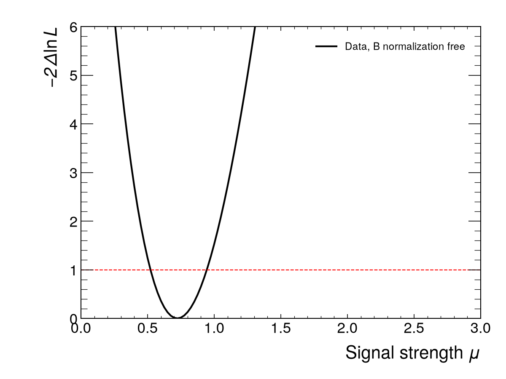

# higgs4l

A small, reproducible analysis of the Higgs boson in the H → ZZ* → 4ℓ channel with the
ATLAS 2025 Open Data for education. It reproduces the official
ATLAS notebook exactly, corrects its selection (pT cuts on pT-sorted leptons, Z1/Z2 pairing)
and its significance estimate, and then adds three things: an unbinned likelihood fit of the
Higgs mass with a calibrated, toy-validated uncertainty (m_H = 125.06 ± 0.93 GeV); a
profile-likelihood significance with pyhf (3.96σ observed, 6.64σ expected); and a classifier
on lepton kinematics whose expected gain, measured on events it never saw, turns out to be
zero. 

## Results

Every number comes from a JSON file in `results/`, regenerated by `scripts/make_all.py`.
"Window" is 122.5-130 GeV; "corrected" is the Z-paired selection with signed weights.

| Quantity | Value | Method |
| --- | --- | --- |
| Notebook S+B / B in the window (printed as N_sig / N_bg) | 28.729 / 10.301 | notebook selection, abs weights (`phase1.json`) |
| Notebook metric (S+B)/√(B+0.3B²) | 4.426, reproduced exactly | same |
| Asimov Z in the window, notebook / corrected selection | 4.70 / 7.82 | counting, Cowan et al. (`phase1.json`) |
| Peak calibration δ (fitted DSCB mean − 125 GeV) | −0.350 ± 0.010 GeV | DSCB fit to signal simulation (`mass_model.json`) |
| Toy pulls of m_H, mean / width | −0.010 ± 0.023 / 1.013 ± 0.016, 0 failed fits | 2000 toys at simulated yields (`mass_toys.json`) |
| Expected error on m_H | 0.50 GeV | median MINOS error of the toys |
| m_H on held-out simulation | 125.15 GeV (generated 125.0) | odd-event simulation as pseudo-data (`mass_simulation.json`) |
| **m_H, data** | **125.06 +0.93 −0.92 GeV** (stat. only) | unbinned fit 110-140 GeV, 84 events, MINOS (`mass_fit.json`) |
| m_H, ATLAS 36.1 fb⁻¹ 4ℓ / PDG 2026 | 124.79 ± 0.37 / 125.13 ± 0.11 GeV | references, for comparison |
| Expected Z, shape fit 110-160 GeV | 6.64 (s+b toys: 6.50 ± 0.04) | pyhf, Asimov, free background normalization (`significance_expected.json`) |
| **Observed Z, data** | **3.96** (p0 = 3.8e-5) | same model, asymptotic (`significance.json`) |
| **Signal strength μ̂, data** | **0.72 +0.22 −0.20** | profile scan |
| Fitted / simulated background, 110-160 GeV | 96.6 / 53.7 events | same fit |
| Classifier ROC AUC, test half | 0.702 | logistic regression, 10 features, no m4l (`ml.json`) |
| Expected Z, test half, inclusive / two categories | 6.06 / 5.97: no gain | pyhf, Asimov |
| Observed Z, data, two categories | 3.29 (inclusive, same templates: 3.90) | frozen classifier and threshold (`ml_data.json`) |

All significance methods side by side are in `results/significance_table.md`; per-cut yields
in `results/cutflow.md`.

## Figures




## How to run

```bash
python3 -m venv .venv
.venv/bin/pip install -r requirements.txt
.venv/bin/pip install -e .
.venv/bin/pytest -q -m "not network"         # uses the committed data/selected
.venv/bin/python scripts/make_all.py           # every number and figure, about 30 minutes
.venv/bin/python scripts/make_all.py --network # also redownloads the samples (about 1 GB)
cd report && latexmk -pdf main.tex
```

`make_all.py` runs the scripts in order: `phase1_numbers`, `plot_m4l`, `mass_model`,
`mass_toys`, `mass_simulation`, `mass_data`, `significance`, `significance_data`,
`classifier`, `classifier_data`. Each script's docstring says what it reads and writes.


## Credits

- ATLAS Collaboration, ATLAS Open Data for education and outreach, release
  `2025e-13tev-beta`, CC0, doi:10.7483/OPENDATA.ATLAS.B5M9.44TN
  ([record 93910](https://opendata.cern.ch/record/93910)).
- The official notebook `HZZAnalysis.ipynb` in
  [atlas-outreach-data-tools/notebooks-collection-opendata](https://github.com/atlas-outreach-data-tools/notebooks-collection-opendata/tree/master/13-TeV-examples/uproot_python),
  the starting point of this analysis.
- Other references are listed in the report.
